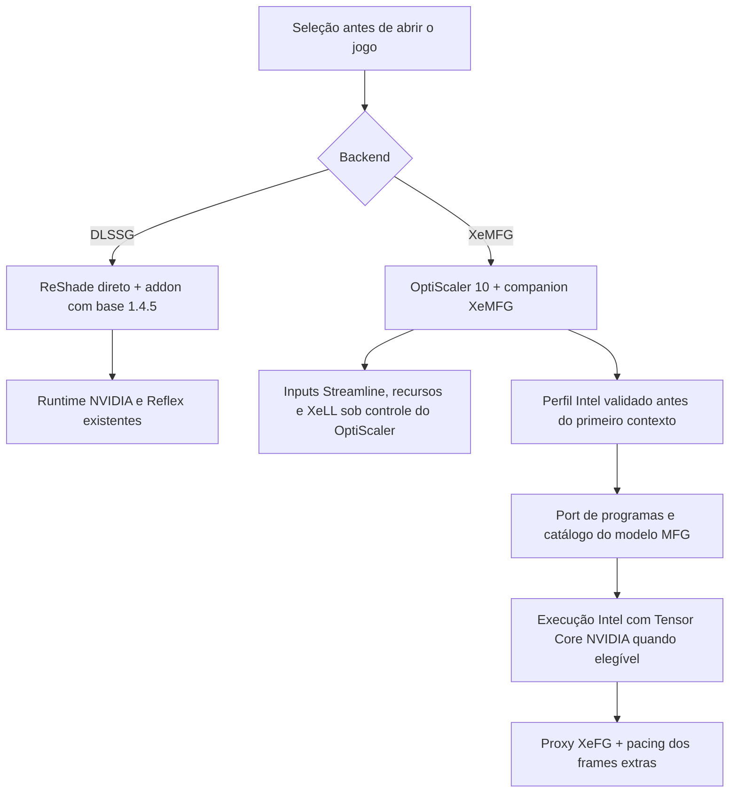

# DLSS-G + XeMFG — primeira integração X1

## Base e resultado

Branch `feature/1.4.5-xemfg`, criada diretamente da **1.4.5 oficial**, commit `0fe65579d287581107babe267ee3e48c9135bf8a`. As árvores antigas, a release publicada e os experimentos de reconstrução foram preservados. Nenhuma alteração de LMR/MR/CA/DR/TGL integra esta candidata.

A build contém dois backends selecionados antes de iniciar o jogo:

- **DLSSG:** geração, qualidade, guard e controle da base 1.4.5; carregador ReShade direto.
- **XeMFG:** inputs DLSS-G/Streamline recebidos pelo OptiScaler 10, modelo MFG Intel adaptado, 2x–6x, XeLL e apresentação pelo proxy XeFG. Nosso addon não instala os writers DLSS-G nem executa seu controlador Reflex nesse modo.

O produto é composto por `renodx-mfgunlock.addon64` e `plugins/MFGAdaUnlock.XeMFG.asi`. O segundo é compilado de código-fonte integrado; **não é o ASI do dashdogy renomeado**. O OptiScaler permanece uma dependência externa. Esta integração não converte inputs Streamline independentemente dele.

O seletor `Switch-MFGBackend.ps1` exige jogo fechado, verifica o pacote, faz backup dos arquivos atingidos e troca também o perfil do carregador. Isso preserva o DLSS-G nativo da 1.4.5 sem colocar outro gerador sobre ele. O OptiScaler e suas configurações permanecem disponíveis para voltar ao XeMFG. A primeira instalação guarda o plugin MFG anterior; ele não deve continuar ativo junto desta candidata. O RenoDX de Cyberpunk e suas configurações de imagem são preservados.

## Implementação e fronteiras

Reutilização de código MIT do [MFG-Unlocker](https://github.com/dashdogy/MFG-Unlocker/tree/a4cf2c4ab632e84c72254932793bb9e64b33d76e/source/native/xess), commit fixado `a4cf2c4ab632e84c72254932793bb9e64b33d76e`: perfis de instruções, port de shaders/modelo, count unlock transacional, pacing, rota Tensor Core e auxiliares necessários. A origem e as adaptações estão em `src/addons/mfgunlock/xemfg/vendor/PROVENANCE.md`; avisos MIT/MinHook/Intel são distribuídos e incorporados ao companion.

Foram escritos o adaptador de ciclo de vida, a admissão do host, seleção exclusiva, API de estado para o painel, build, empacotamento e troca/restauração. Não foram importados renderer/menu do projeto de referência, reparo de motion vectors, matching de HUD, override de scene cut, nem seu backend NVIDIA. HUD/UI fica sob a integração já existente do OptiScaler/XeFG; esta build não acrescenta uma heurística para a crosshair.

Nesta primeira build, o port é admitido em **GPU NVIDIA**, com OptiScaler de versão principal 10 e este conjunto explicitamente revisado:

| Componente | Versão / SHA-256 |
|---|---|
| XeSS-FG | 1.3.1.78 — `ec5e0c65e075570c6ede72618bb666d0be0c2e10b2ea9762c0fe8cb8e375ab27` |
| XeLL instalado | 1.3.0.5 — `61aeeab7fdcfb6d1742f86c14c68c663d759607d01a6132645c857291eaebb86` |
| XeLL alternativo admitido | 1.3.2.10 — `d2030dcd694fda8f2ec7e044b13e6db8f0b56d4ba9113a5efad334e3f3ded8c7` |
| OptiScaler instalado | 10.0.0.1; build `024c4a1b`; `cea0ef7e4940ad04fd1bcddabbabf7cd307fc2449b460e7e539597f344229b91` |
| ASI fornecido pelo usuário, usado somente como fonte de dados | 1.6.0.1010 — `161b9e1245a3736dc462ee83f4ad51e6125d8e7e73ce3eedde89d2eed60c69fa` |

Hashes dos arquivos e witnesses da imagem em memória são conferidos antes dos patches. A preparação do port ocorre antes de encaminhar o primeiro `CreateContext` observado do host. Um contexto estrangeiro observado antes disso impede a publicação. Módulos, callbacks e payloads publicados têm duração de processo; a troca exige reinício. Não há hot unload do companion. Essa política não transforma o mecanismo de inicialização do loader em uma garantia para todos os hosts: inicialização tardia e providers já utilizados por terceiros não são uma configuração admitida.

Uma falha de identidade deixa XeFG no comportamento nativo; não há fallback para um modelo 2x usado em fases incorretas. Se o port estiver aplicado mas o registro do pacing falhar, a inicialização MFG é recusada e FG é desabilitado naquele contexto. A capacidade anunciada/aceita não deve ser confundida com frames exibidos.

O modelo MFG e seu conjunto de 54 programas são publicados em vez de apenas elevar a contagem. A rota Tensor Core usa kernels de referência reconhecidos por programa e executa nas listas do próprio provider; falhas de admissão mantêm o caminho DXIL. O pacing dos frames extras utiliza os hooks perfilados do SDK. O metering NVIDIA é habilitado somente quando as funções e a fila têm ownership demonstrado; recusa do driver mantém o pacing de software. A resolução da função e da fila não prova que metering esteja efetivo no monitor.

## Evidências e limites

Verificações realizadas na RTX 4070 SUPER:

- Compilação dos dois binários e suíte: **40 testes passaram; 3 opcionais foram pulados**, de 43 registrados. Os skips são `provider_identity` sem entradas NVIDIA explícitas e os dois manifests de targets históricos que não são este pacote.
- Probe Intel com DLLs reais, sem contexto/GPU dispatch: 54 identidades de programas e sete replacements validados; três ciclos completos de port/unlock/restore; quatro capacidades inválidas e um site alterado recusados. As seções executáveis voltaram aos bytes iniciais, e o unload normal do provider não falhou.
- Host sintético, DLLs Intel reais e dispositivo D3D12 real: criação de contexto, capacidade de cinco intermediários, XeLL associado, inicialização de swapchain oculto, registro do pacing, alterações de contagem 2x/3x/4x/6x, enable/disable e destruição retornaram sucesso. Catálogo portado, pipelines reconhecidos e rota Tensor Core foram admitidos. **Não houve Present nem geração de imagem neste teste.**
- O mesmo harness confirmou zero hooks quando DLSSG está selecionado e quando o provider em disco tem hash alterado.
- Instalação em diretório sintético: XeMFG → DLSSG → restauração exata do estado inicial; addon de Cyberpunk, upscaler e plugin anterior preservados. Testada com fixture e cópia do loader OptiScaler real.

Os resultados ficam no pacote/manifest e no diretório ignorado `build/xemfg/source/build/`. Eles não demonstram melhoria visual, ganho de FPS, cadência exibida, latência física ou funcionamento de todos os jogos. A validação real da integração Cyberpunk fica pendente até o usuário abrir a cena. O estado `initialized`, número efetivo apresentado e os lançamentos Tensor Core serão conferidos no painel/log da execução real; um checkbox sozinho não é essa evidência.

Os [contratos Intel](https://github.com/intel/xess/blob/de0fb9c1c510661c571164e1418ceca8101dab69/doc/xess_fg_developer_guide_english.md) exigem XeLL e descrevem o proxy de apresentação; o SDK nativo limita não Intel a um frame gerado. O port é uma modificação independente e não suporte oficial Intel a MFG em Ada. Não se promete qualidade de 60 FPS reais a 25–40 FPS reais.

## Reprodução e entrega

`tools/Build-XeMFG.ps1` recebe checkout RenoDX, headers Intel e ASI de dados explícitos. Os três headers NVIDIA gerados devem coincidir com a 1.4.5 oficial. `prepare_xemfg_inputs.py` faz parsing estático do PE, sem carregar código do ASI, confere o SHA completo, o manifesto de 54 programas e os hashes dos sete shaders/fatbin. Todos os blobs ficam em `build/`, ignorado. Os programas derivados da Intel mantêm seus termos; não são publicados como código MIT. O SDK Intel e seus pesos não são incluídos no pacote.

Headers Intel consultados: commit `de0fb9c1c510661c571164e1418ceca8101dab69`; referência OptiScaler consultada: commit `c2e44a8bc911010d7ed3e4fa63843185fbb55d03`. A build usa os blobs pré-compilados conferidos, não alega ter recompilado HLSL/CUDA nem provar equivalência numérica independente dos kernels do autor.

Pacote local: `out/dual-backend-1.4.5-x1/`, com binários, manifest, licenças, seletores e addon oficial 1.4.5 para rollback. Não foi publicada uma release. O primeiro teste recomendado é o ManualSave-317 em 4x, com os mesmos ajustes, verificando também crosshair, asfalto e contagem efetiva no painel do OptiScaler. Antes de promover, comparar dois jogos, enable/disable repetido, resize/alt-tab, 2x/3x/4x/6x e medir desempenho/pacing/VRAM sem profiler.
