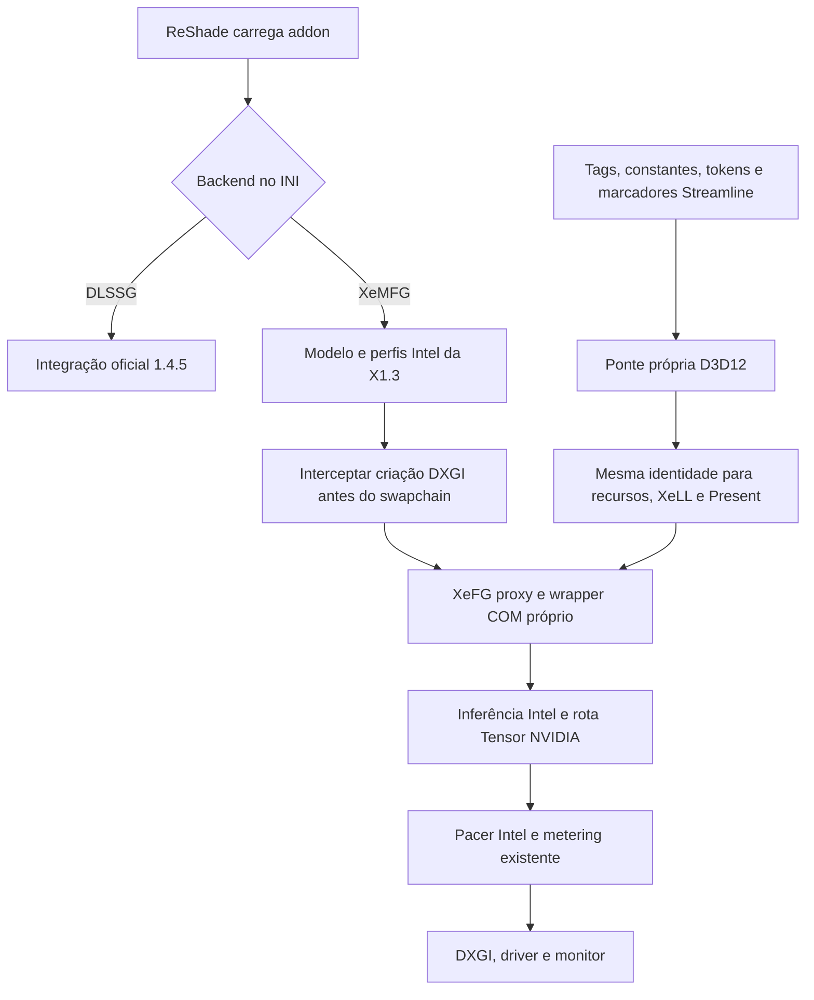

# XeMFG nativo no ReShade — R1

Data: 19/10/2026. Branch: `feature/1.4.5-xemfg-reshade`, derivada da X1.3 (`0d8dc0b6d9aff9aad9afaf57f6939e94fada93c5`), descendente da 1.4.5 oficial (`0fe65579d287581107babe267ee3e48c9135bf8a`). A árvore antiga modificada, a X1.3 e a release publicada foram preservadas.

## Entrega

Um `.addon64` contém os dois backends e seu painel ReShade. A escolha é exclusiva e fixada ao iniciar o processo. No modo DLSS-G, continuam as políticas da 1.4.5. No modo XeMFG, a ponte própria recebe os inputs Streamline e usa os componentes MIT já validados: modelo Intel MFG, programas adaptados, desbloqueio de multiplicador, CUDA/Tensor e pacing/metering. Não há dependência de OptiScaler ou ASI no caminho nativo. As DLLs Intel continuam necessárias.

A ponte nova foi escrita a partir dos contratos públicos Streamline, Intel e DXGI; não se importou implementação GPL do OptiScaler. Houve leitura de referência de configuração/ordem de chamadas, sem transplante de suas classes, shaders, conversores, hooks, renderer ou gerenciamento de recursos. Os componentes de dashdogy permanecem em `vendor/`, com proveniência e avisos originais. Dados Intel incorporados conservam seus termos próprios.

## Fluxo e limites de controle

O evento ReShade `create_swapchain` não permite trocar o COM retornado; `init_swapchain` é tarde para a API Intel que recria um swapchain existente. A ponte intercepta `IDXGIFactory2::CreateSwapChainForHwnd` da fábrica observada antes de seu primeiro uso e chama `xefgSwapChainD3D12InitFromSwapChainDesc`. Uma guarda de reentrada permite a criação interna pelo SDK. Um wrapper `IDXGISwapChain4` próprio possui a identidade COM e faz a preparação antes de `Present/Present1`, sem inferir destruição pelo contador de referências de outro proxy.

O dispositivo ReShade é preservado na criação do contexto Intel para que as filas e o runtime ReShade continuem disponíveis. A identidade nativa é resolvida separadamente para validar recursos e para a rota CUDA. Um teste inicial usando somente o dispositivo desembrulhado fez o ReShade recusar o swapchain por falta de proxy D3D; isso foi corrigido antes da candidata.

O número de callbacks ReShade `present` não mede o total de frames gerados/apresentados pelo SDK. O teste observou um callback por Present da aplicação e múltiplas submissões reportadas pelo Intel. O painel e os resultados não transformam esse contador em FPS exibido.

## Contratos implementados

- Hooks de `slGetFeatureFunction` e funções de feature já resolvidas, cobrindo ponteiros cacheados; tags legadas e `slSetTagForFrame`; constantes e marcadores públicos via PCL/Reflex. Os módulos interceptados e callbacks publicados têm lifetime de processo.
- `DLSSGSetOptions` registra o pedido e encaminha uma estrutura V1 conhecida com NVIDIA FG desligado. A geração XeFG só é habilitada com confirmação desse desligamento e do Reflex nativo desligado. Não são copiados membros de uma ABI mais nova a partir de buffers antigos.
- `slReflexSleep` é substituído pelo sleep XeLL antes da simulação. O limiter solicitado é transferido; marcadores de simulação, submissão e apresentação mantêm o mesmo ID das constantes e inputs. Não se inventam marcadores de simulação dentro de Present. Sentinelas privadas de versões históricas não são adivinhadas.
- Tokens explícitos têm identidade preservada. Tags legadas são associadas ao token observado em `RenderSubmitStart`; ausência dessa associação desabilita a geração daquele frame. A primeira implementação admite um viewport/output, com cache limitado a 16 frames.
- Inputs `OnlyValidNow`/`ValidUntilEvaluate` usam o contrato Intel `ONLY_NOW` no command list produtor, que registra a cópia naquele ponto e restaura o estado informado. `ValidUntilPresent` mantém sua semântica original. Um simples AddRef não é tratado como preservação de conteúdo.
- Recursos são conferidos por identidade COM do dispositivo, tipo, amostragem, sub-região e estado. Cor HUDless/UI é encaminhada quando fornecida pelo jogo; não há novo detector de HUD ou alteração dos vetores. Recursos e constantes inválidos desabilitam FG, sem blur, frames repetidos ou alteração silenciosa dos inputs.
- A escala de movimento normalizada do Streamline é convertida para o modo de pixels Intel usando a extensão válida dos MVs. A matriz de visão é construída com posição e base de câmera; a projeção sem jitter vem das constantes. Flags de depth/jitter devem coincidir com a inicialização.
- Transições de enable/multiplicador usam o pacing já validado. Resize limpa o cache de inputs e a continuidade; o próximo frame reinicia o histórico do SDK. Formatos novos não suportados impedem geração. Destruição libera o proxy público antes do contexto Intel e o XeLL por último. Se a retirada do SDK falhar, suas dependências são retidas até o fim do processo.

## Verificação executada

Build MSVC 19.44 / VS 2022, SDK Windows 10.0.26100.0, driver NVIDIA 617.42, RTX 4070 SUPER. ReShade real 6.8.0.2155; XeFG 1.3.1.78; XeLL 1.3.0.5. Os hashes exatos, fontes e inputs efetivos de compilador/linker estão no manifesto do pacote.

`cmake --build build/tests --config Release -j 2` e `ctest --test-dir build/tests -C Release --output-on-failure`: **50 passaram, 3 opcionais ignorados, nenhum falhou** (53 cadastrados). Os ignorados são `provider_identity`, `engineering_manifest` e `release_1_4_5_manifest`, dependentes de inputs/artefatos históricos adicionais; não são o teste do addon nativo.

Os quatro novos testes usam um chamador Streamline sintético, com DLL de fixture própria, mas **ReShade, D3D12, XeFG, XeLL, modelo e execução Tensor reais**. Em 2x/3x/4x/6x, verificam inferência, os setters e status do SDK, ambas APIs de tags, cópia de inputs temporários, bypass por MV ausente, recuperação, desativação, resize e contexto retirado sem leak. Também continuam passando os testes do companion anterior, incluindo publicação antes do primeiro consumidor, redirects do host e patch/restore dos providers.

As janelas de teste retornaram `DXGI_STATUS_OCCLUDED`. Em 4x, por exemplo, o SDK reportou três submissões geradas e resultado de interpolação zero; esse resultado **não comprova quatro frames exibidos**. A inferência e os lançamentos Tensor são observáveis; cadência, ausência de flicker, HDR, FPS e latência física no jogo continuam pendentes. O relato de qualidade perfeita pertence à X1.3 com outro transporte.

## Escopo inicial e riscos pendentes

O alvo inicial é NVIDIA/D3D12/Streamline, começando pelo Cyberpunk. Outputs SDR RGBA8/BGRA8 e HDR10 RGB10A2 são admitidos. Não há conversão genérica de FP16/scRGB, Vulkan, DX11, inputs NGX diretos, swapchains CoreWindow/composição, nem controle geral de múltiplos viewports/adapters. A API não permite FG em fullscreen exclusivo. Backend requer reinício; hot unload não é anunciado como seguro.

Precisam de validação real: seleção efetiva do swapchain pelo jogo, ordem/identidade dos marcadores, flags e escala dos inputs, domínio da cor HUDless em HDR/RenoDX, UI composition nativa, overlays, cadeias de proxies NVIDIA/ReShade e status/cadência após oclusão/alt-tab. Formato de storage não é prova de encoding; não foi implementada uma transformação arbitrária de cor. O novo transporte ainda não recebeu aprovação visual/perceptual do usuário nem benchmark comparativo com X1.3.

O instalador faz backup e rollback da configuração inteira afetada antes de substituir o carregador OptiScaler pelo ReShade. Preserva o RenoDX do jogo, shaders/preset e os runtimes. O pacote inclui o rollback oficial 1.4.5 e restauração exata da instalação anterior. Não houve publicação de release.

## Referências primárias

- [Guia Intel XeSS-FG, revisão fixada](https://github.com/intel/xess/blob/de0fb9c1c510661c571164e1418ceca8101dab69/doc/xess_fg_developer_guide_english.md): criação, XeLL, inputs, estados, validade e composição.
- [Streamline 2.8](https://github.com/NVIDIA-RTX/Streamline/blob/v2.8.0/docs/ProgrammingGuide.md) e [DLSS-G](https://github.com/NVIDIA-RTX/Streamline/blob/v2.8.0/docs/ProgrammingGuideDLSS_G.md): lifecycle, tags, tokens e constantes.
- [ReShade](https://github.com/crosire/reshade): headers de eventos e implementação de fábrica/dispositivo consultados também no checkout local usado no build.
- [MFG-Unlocker MIT, revisão fixada](https://github.com/dashdogy/MFG-Unlocker/tree/a4cf2c4ab632e84c72254932793bb9e64b33d76e): componentes preservados em `vendor/` e seus avisos.
